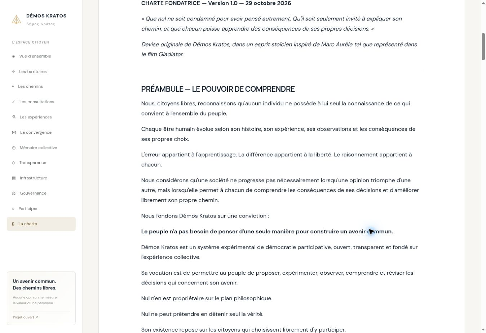

# Corrections de l’audit et rendu de la charte

29 octobre 2026. Ce lot corrige les sept écarts reproduits dans l’audit et le rattachement des exports d’expériences. Il améliore la charte signalée lors du lancement local. Il conserve Symfony 8.1, PHP 8.4, SQLite et les trois villes demandées.

## Fonctionnement obtenu

| Point | Correction | Vérification |
| --- | --- | --- |
| AUD-01 : brouillons | Titre et territoire suffisent pour enregistrer un brouillon ; publication et consultation exigent toujours les informations complètes. | Sonde initiale, refus de publication incomplète, soumission HTTP avec CSRF. |
| AUD-02 : catégories | Les douze rubriques fondatrices sont conservées ; des catégories supplémentaires peuvent être ajoutées et révisées depuis leur fiche, sans JavaScript. | Treizième nœud créé par formulaire puis conservé dans une révision HTTP. |
| AUD-03 : relations | Relations typées persistées, extrémités et doublons validés ; cycles refusés pour le sous-graphe « cause de / contribue à ». | Sonde, extrémité inexistante, cycle, auteur incorrect et gel de consultation. |
| AUD-04 : révisions | Titre, problème, résumé, cause, conséquence, solution, justification, indicateur, prévision, risques, retour arrière, thème, tags, nœuds, liens et sources sont révisables. Le snapshot précédent reste accessible. | Révision HTTP complète, sources anciennes conservées, signatures recalculées. |
| AUD-05 : nom effacé | Les nouvelles charges de journal ne stockent plus les noms de création/rectification. Les anciennes charges concernées sont expurgées à la demande d’effacement, avec une attestation signée. | Ancien format signé fabriqué dans le test, expurgation vérifiée, trois variantes de falsification rejetées. |
| AUD-06 : bilan publié | Une seconde évaluation du même protocole est refusée ; le bilan publié et son événement ne sont pas remplacés. | Sonde de double évaluation. Une expérience ultérieure doit disposer de son propre protocole. |
| AUD-07 : échéance | Trois phases affichées : ouverte, échue en attente de proclamation, close. L’échéance n’autorise plus les boutons de vote ; la clôture reste une opération motivée et signée. | Sonde d’échéance et contrôle du rendu Twig. Aucun résultat n’est proclamé automatiquement par simple lecture. |
| Export d’expérience | Le texte exporté vient du snapshot de la consultation ; sa version est explicite. Les anciennes expériences sont résolues depuis leur consultation, sans réécriture des données. | Export HTTP après révision de la proposition : le texte ancien soumis au vote reste exporté. |
| Charte | CommonMark remplace le découpage ligne par ligne. Titres, listes, emphases et paragraphes deviennent des éléments HTML ; `white-space: normal` remplace `pre-wrap`. | Rendu des 28 locales ; 24 articles français, sept titres et liste des douze catégories contrôlés. |

L’ajout d’une source ou d’un élément causal constitue une révision motivée, soumise aux mêmes contrôles d’auteur et de gel que le formulaire général. Les sources existantes sont éditables depuis la révision ; une action dédiée permet d’en ajouter sans JavaScript.

## Expurgation et preuves

Une attestation ne prétend pas recomposer l’original supprimé. Elle conserve l’empreinte et la signature originales, et signe l’empreinte de la représentation expurgée, les champs retirés, le motif et la date. Le vérificateur exige les deux signatures et vérifie encore le chaînage et l’état courant. La suppression ou l’altération de l’attestation rend la preuve invalide.

Cette procédure ne permet pas de rappeler un export déjà téléchargé, d’effacer automatiquement un nom écrit librement dans une proposition ni d’établir la conformité d’un service contenant des données politiques réelles. La démonstration reste fictive. L’opérateur qui détient la clé garde les limites de confiance déjà documentées ; aucun ancrage public indépendant n’est ajouté par ce lot.

## Rendu visuel vérifié

L’adresse de l’utilisateur `http://127.0.0.1:5412/charter` n’était pas accessible depuis l’environnement de réalisation. Le véritable HTML émis par HttpKernel/Twig a été rendu dans un aperçu temporaire, avec le même CSS ; il ne s’agit pas d’un déploiement PHP public.

Vérification dans Chromium : paragraphes en `white-space: normal`, interligne de 28 px et marge de 16 px sur ordinateur, sans débordement horizontal. Un cadre de 390 px (375 px utiles après barre de défilement) vérifie le rendu mobile : contenu sans débordement et texte de charte en espaces normaux. Les captures montrent des paragraphes lisibles et des espacements réguliers. Cela ne remplace pas un audit WCAG/RGAA.



## Tests et installation locale

`composer test` exécute désormais les trois ensembles : **99 contrôles existants + 64 contrôles de correction + 12 sondes d’audit = 175 contrôles satisfaits**, zéro échec. Ce nombre n’est pas un taux de conformité aux 68 scénarios du cahier des charges. Les sondes initialement en échec sont maintenant des protections permanentes en CI.

Preuves : [suite principale](test-results.txt), [corrections](correction-test-results.txt), [sondes courantes](requirements-audit-results.json), [résultat avant correction](requirements-audit-results.before.json).

Après récupération de la branche, depuis la racine du dépôt :

```bash
cd apps/symfony
composer install --no-interaction --prefer-dist
php bin/console cache:clear --env=demo
composer test
```

Recharger `/charter` avec un rechargement forcé pour renouveler le CSS. Aucune nouvelle migration et aucun remplacement du fichier SQLite ne sont nécessaires. `composer.lock` ajoute CommonMark et ses dépendances ; le bundle Profiler Shield reste fixé à la branche et au commit demandés.

## Suite du cahier des charges

L’[audit initial complet](REQUIREMENTS_AUDIT.md) reste une photographie historique. Ce lot ne réalise pas les chantiers plus larges : convergence empirique et temporelle, compte citoyen partagé authentifié, modération et résolution des recours, gouvernance appliquée aux déploiements, SSE/Mercure, réseau de réplication, agent volontaire, sauvegarde/restauration et audits d’accessibilité, de sécurité et de charge. Le modèle métier reste stocké en JSON transactionnel dans SQLite. L’import national et PostgreSQL restent différés conformément au périmètre demandé.
